<p align="center">
  <picture>
    <source media="(prefers-color-scheme: dark)" srcset="brand/logo/web/pebble-white.svg">
    
  </picture>
</p>

<h1 align="center">Aide</h1>

<p align="center">
  A personal assistant for one person, backed by Claude.<br>
  Calendar, reminders, mail, health, habits, study notes, trams and errands on the web, through chat on the phone and the Mac.
</p>

---

Aide is a Python server that runs on a home machine and an app for iPhone and Mac that talks to it over Tailscale. You chat with
**Aide**, which hands the work to a small team of specialists, each with its own chats, tools and memory:

| Agent | Looks after |
|---|---|
| **Aide** | the orchestrator: web, maps, memory, routines, errands in its own browser; asks the others |
| **Secretary** | calendar (iCloud), reminders (Apple Reminders), mail (Gmail), trams and buses (GTT, Turin) |
| **Professor** | courses, lectures, study files, course notebooks, quizzes and practice exams, focus sessions |
| **Coach** | Apple Health, sleep and recovery, habits, food, Screen Time locks |
| **Finance** | money: linked bank accounts (balances, money in, every payment), Apple Pay taps, budget, subscriptions, the orders Aide placed |

Anything destructive or outward-facing (sending mail, deleting an event, moving a reminder, placing an order) is
queued in code and runs only after you tap **Confirm** in the app. The model never runs it directly.

On the phone the app has four tabs, one per area, each opening with a line from its agent:

- **Team:** the chats with Aide and the specialists, the briefing, what's waiting for you, and Today (habits and
  objectives). Settings is behind the gear in the corner.
- **Study:** Professor's courses, with notebooks, lessons, quizzes and practice exams, and focus sessions that
  lock the phone and the Mac while you study (see [Focus sessions](#focus-sessions)).
- **Health:** Coach's Body, Food and Screen. Body has the Strain, Recovery and Sleep scores, last night's numbers
  against your usual (see [Health scores](#health-scores)) and weight against its goal; Coach works out tonight's
  bedtime back from a steady wake time and nudges you in the evening. Food has meals from a photo, a description or a
  barcode. Screen has screen time and its locks and limits.
- **Money:** Finance's month: what's left of the budget (or this month against last), categories, payments by day,
  subscriptions, and the accounts with their balances from your bank (see [Banks](#banks)).

The briefings (the wake-up one, evening, week, month) bring the day's calendar, reminders, mail, sleep and the
weather where you are; Secretary drafts replies to mail that asks something of you, sent only from the app.

Around them are routines and watches (an agent's scheduled job, or a check that posts only when something needs
you), widgets, and Live Activities on the Lock Screen and in the Dynamic Island (the next tram, the next event, an
agent at work, a focus session's round, the time to bedtime).

The **Mac app** is the same app in a window. It has the sections in a sidebar, the day at a glance under them, and
Pebble in the menu bar for a quick look. It also has its own screen time: the Mac counts its apps and websites and
enforces the phone's locks itself.

The API is in [docs/API.md](docs/API.md), the contract between the server and the app. [SPEC.md](SPEC.md) is the
original plan, and [CLAUDE.md](CLAUDE.md) is where things stand.

## Screenshots

**iPhone:** Study, a course, Health (Body, Food, Screen) and Money.

<p align="center">
  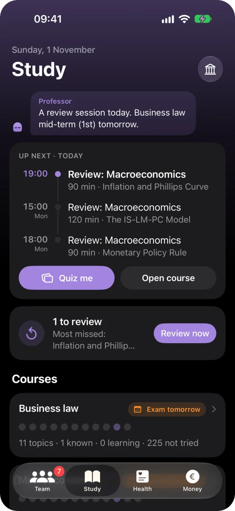
  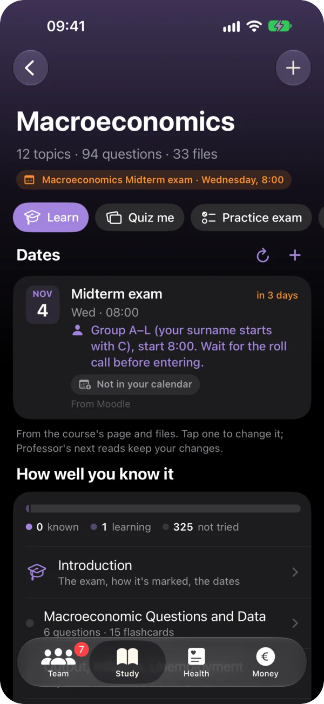
  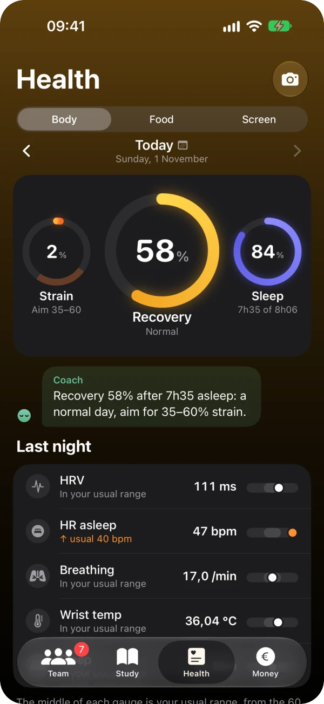
</p>
<p align="center">
  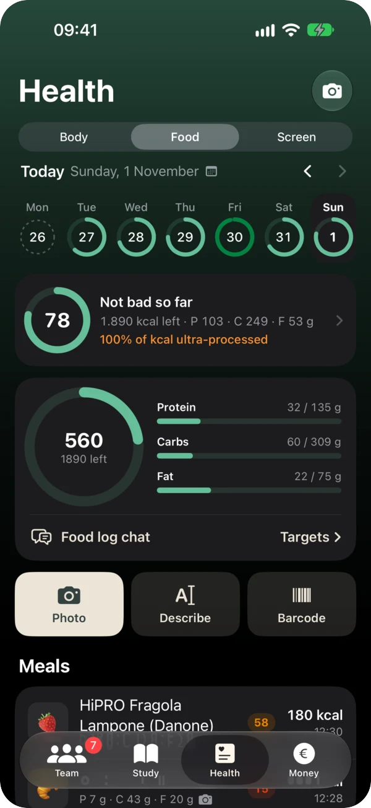
  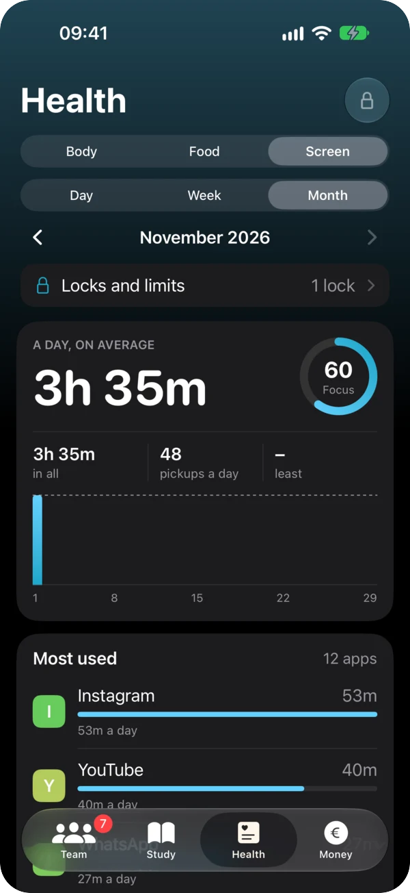
  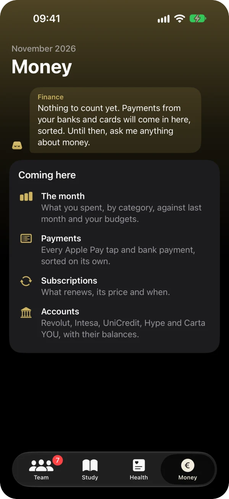
</p>

**Mac:** Study, Health, Food and Screen, with the sidebar and the day at a glance.

<p align="center">
  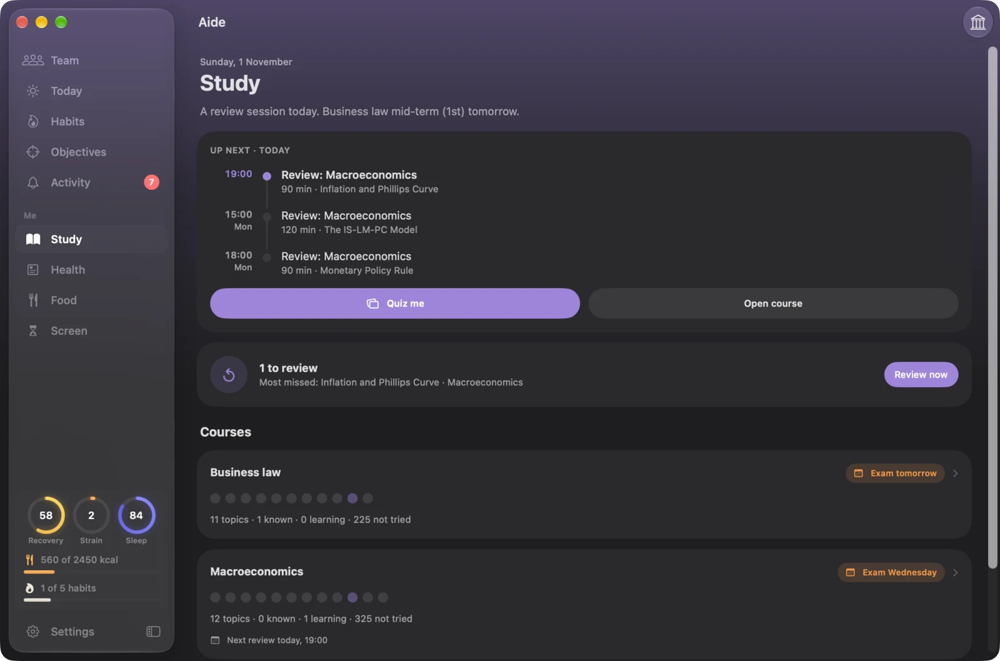
  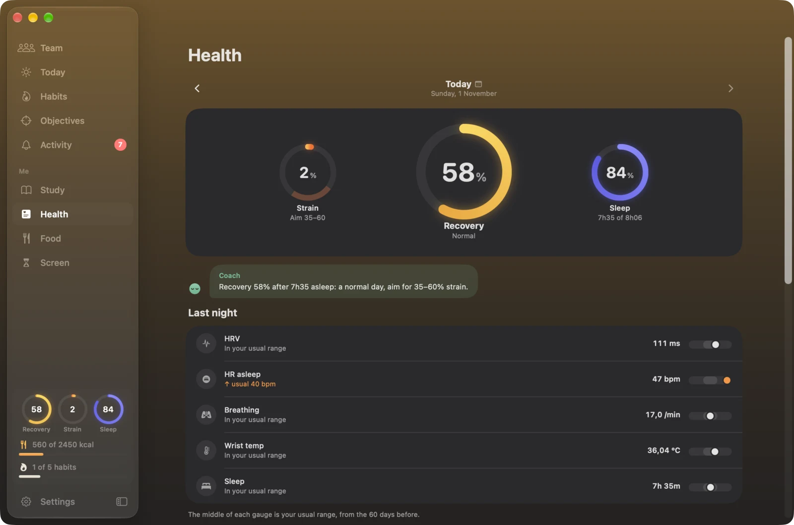
</p>
<p align="center">
  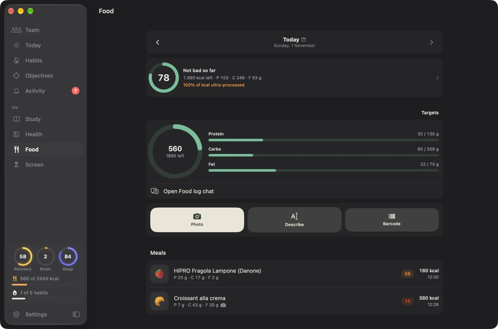
  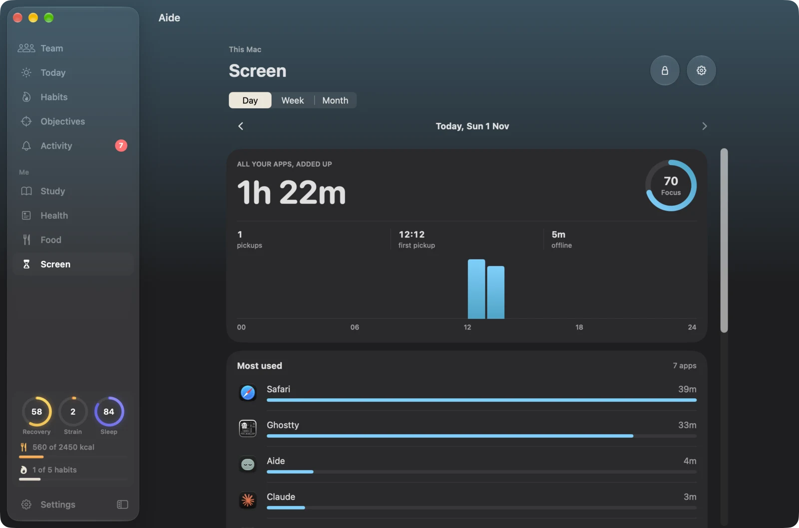
</p>

## How it fits together

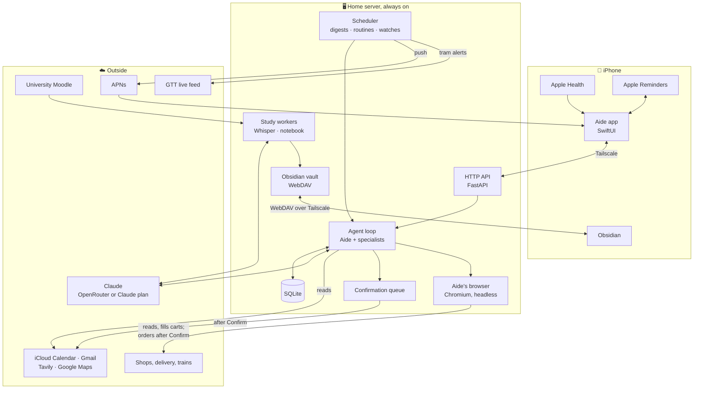

## Health scores

The Health page opens on three rings, Bevel-style: **Strain**, **Recovery** and **Sleep**, each 0–100 and each
opening a page with what it's made of and the last 30 days. They're worked out on the server (`scores.py`, contract
in [docs/API.md](docs/API.md), "Scores") from the days the app uploads from Apple Health, against your own past
rather than population norms, so Coach, the wake-up briefing and the app all quote the same numbers. None of it is
medical advice.

| Score | From | How |
|---|---|---|
| **Sleep** | last night's sleep and the 14 before | hours asleep against the need (7h30, plus half of what the last 3 nights were short, at most +1 h) 50%; deep and REM share 20%; time asleep in bed 15%; bedtime against your usual 15% |
| **Recovery** | HRV, resting heart rate, the sleep score | each against a 60-day baseline (median and MAD): HRV 50%, resting HR 30%, sleep 20%, so a usual night lands in the 60s. Breathing rate (+1/min) or wrist temperature (+0.5 °C) above usual caps it at 50. Needs 14 days to calibrate |
| **Strain** | heart-rate minutes per 5-bpm band | Banister's TRIMP above 40% of your heart-rate reserve (walking about isn't load), as `100·(1 − e^(−TRIMP/150))`: a hard hour is ~60%. Recovery sets the day's target (low 10–35, normal 35–60, good 55–80). Before heart rate arrives, estimated from workout calories |

Also: heart-rate zones and each workout's share of the day's strain, and cardio load, the last 7 days' average
TRIMP against the last 28 (detraining under 0.8×, maintaining, building 1.0–1.3×, overreaching above). The phone
sends only summaries of heart rate (minutes per band, hourly averages, the day's top); the samples stay on it. The
constants are at the top of `scores.py`.

## How study notes are made

Professor turns everything a course produces (lecture recordings, slides, Moodle PDFs) into notes you can study
from, in Obsidian on the phone and the Mac. Two kinds of notes come out of it:

- **Lecture notes**: one page per lecture, written as soon as the lecture is in.
- **A course notebook**: an Introduction on the exam, then one page per topic in the order it's taught, with an
  explanation, key terms, formulas, worked examples, figures from the slides, exam-style questions with checked
  answer keys, and flashcards. It grows as new material comes in, but nothing is written until you say yes.

### From material to notes

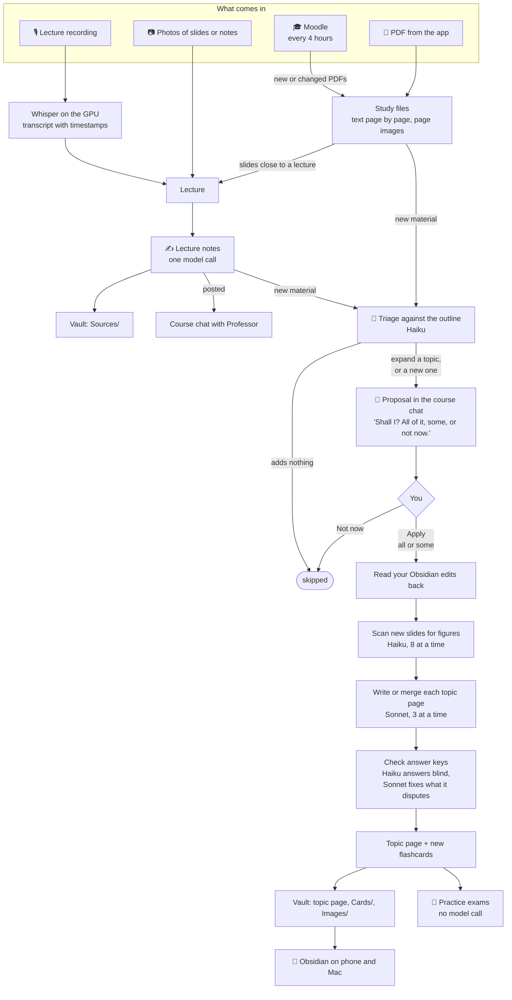

The model calls run in background workers, one job at a time, outside the chat turn that asked for them. They go
through OpenRouter or through your Claude plan (Claude Code on the server, `claude -p`), as set in the app under
Settings → *Claude plan*. When the plan hits its limit, the job pauses and Professor asks whether to wait
for the reset or finish on OpenRouter.

### Starting a notebook

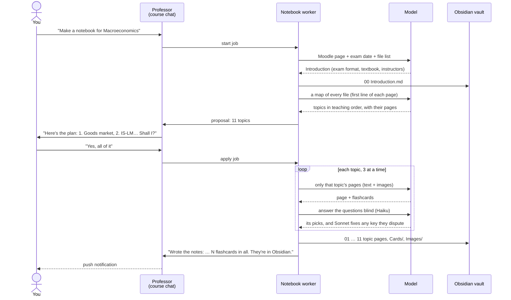

### Example: a new PDF on Moodle, a week later

1. Moodle sync finds `Lecture 7 - Open economy.pdf` and adds it to the course's study files.
2. Triage reads the notebook's **outline** (titles, summaries, headings, not the text) and the file's page map,
   and finds what's new:
   > New in Macroeconomics: Lecture 7 - Open economy.pdf. I'd add to the notes:
   > 1. Expand **IS-LM model**: the open-economy IS curve with net exports (p. 3–6)
   > 2. New topic **Exchange rates**: nominal vs. real, uncovered interest parity (p. 7–15)
   >
   > Shall I? All of it, some, or not now.
3. You answer "just 2" in the chat, or tap **Apply** in the Study tab.
4. The worker pulls your latest edits from Obsidian, writes *Exchange rates* from pages 7–15 only, checks its
   answer keys, and slots it in after *IS-LM model*. Its flashcards are **appended** to `Cards/`, so the
   Spaced Repetition plugin's review history is never lost.

What ends up in the vault for one course:

```
Aide/Macroeconomics/
├── 00 Introduction.md          the exam, textbook, instructors
├── 01 The goods market.md      explanation · key terms · formulas · worked examples
├── 02 The IS-LM model.md       · figures · exam-style questions (folded answers)
├── …
├── Formulas.md                 every topic's formulas, gathered (the formulario)
├── Exercises/                  per topic: the sheets' and past exams' exercises, and new ones, solved
├── Mock exams/                 papers like the real exam: the questions, then the answers and marking
├── Cards/                      question :: answer, tagged #flashcards/macroeconomics
├── Images/                     slide figures the topic pages show
├── Sources/                    one page per lecture: its notes
└── Files/                      the PDFs
```

Topic pages are shared: edit them in Obsidian and your wording stands; Aide builds on it the next time it adds
material. Any other page you edit becomes yours, and Aide leaves it alone.

### What it costs

Rough numbers for **100 slides**, from the macroeconomics notebook (449 slides, 11 topic pages, 163 flashcards).
Aide doesn't count tokens, so these are estimates from the sizes it sends, not a bill.

| Job | Model | On the API (OpenRouter) |
|---|---|---|
| Scanning the slides for figures (13 calls of 8 slides) | Haiku | ~$0.01 |
| 2–3 topic pages: the slides' text, 6 slide images, the page and its cards back | Sonnet | ~$0.10–0.20 each |
| Checking each page's answer keys (Haiku answers blind, Sonnet looks at the disputed ones) | Haiku, Sonnet | ~$0.01–0.03 each |
| **100 slides, in all** | | **~$0.30–0.60** |
| Once per course: the Introduction and the topic plan | Sonnet | ~$0.10 |
| Later: triage of a new file, then a merge per topic it adds to | Haiku, Sonnet | ~$0.01, then ~$0.10–0.15 each |
| Notes for a 90-minute lecture (Whisper runs on your GPU, free) | Sonnet | ~$0.10–0.25 |

At Sonnet 5.5 at $2 / $10 and Haiku 5.5 at $0.10 / $0.50 per million tokens in / out, plus OpenRouter's ~5%.
Almost all of it is Sonnet writing. A whole course (~450 slides and ~24 lectures) comes to about $5–10.

**On a Claude plan** (Settings → Claude plan), the notes cost nothing extra; they use the
plan's limits instead. Those reset every 5 hours, with a weekly cap on top, and aren't published in tokens, so
these are guesses. Check `/usage` in Claude Code on the server for the real picture:

| Plan | 100 slides | A whole course's notebook |
|---|---|---|
| **Pro** | a good share of one 5-hour window | likely 2–3 windows: Aide pauses at the limit, and Professor asks whether to wait or finish on OpenRouter |
| **Max 5x** (5× Pro) | a small part of a window | about one window |
| **Max 20x** | hardly noticed | a fraction of a window |

The plan is shared with your own Claude use: a notebook written while you code in Claude Code takes from the
same window.

## Focus sessions

A focus session is study in rounds with breaks between them: 25/5 × 4, 50/10 × 2, or your own (rounds of 15–120 min,
up to 8). Start one with **Focus** on a course or topic page, from a review session, or by asking Professor
("focus on chapter 3 for an hour").

- **Rounds lock.** Each round is a strict Screen Time lock over everything except what you study with. On the phone
  that's the apps picked in Settings → Screen Time → During focus (pick Aide, so the Study page stays open). On the
  Mac, Aide closes every app you switch to except its focus apps (Notes, Preview, Obsidian… in Settings → This Mac →
  Screen Time). Breaks unlock both.
- **Ending early** a strict round takes an emergency pass (3 a month), else a reason that Professor and Coach see.
  A break ends freely.
- **On the Lock Screen and in the Dynamic Island**, a Live Activity shows the round or break, the time left and the
  topic, with a sound at each switch.
- **At the end**, Professor posts the session in the course chat (rounds, minutes, why it ended early if it did), and
  the app offers five quick multiple-choice questions on what you studied (no model call). Professor adds how they
  went.
- **It counts.** Minutes per course go into Professor's study progress and plans, the `focus` objectives measure, and
  what Coach sees of your day.

## Layout

```
src/aide/
  __main__.py            entry point: wires settings, db, agent, API, background jobs
  config.py              settings from the environment
  db.py                  SQLite (WAL): conversations, messages, audit_log
  agent.py               Claude tool-use loop, conversation history, the confirmation queue
  agents.py              Aide and the specialists: prompts, tool sets, colours, starters
  tools/                 everything that touches the outside world: calendar, reminders, mail, web, maps…
  channels/api.py        the HTTP API the app uses (FastAPI)
  scheduler.py           background jobs; routines.py: scheduled agent jobs and watches
  digest.py              daily, weekly and monthly digests; objectives.py: each specialist's objectives
  reminders.py, habits.py, photos.py
  food.py, foods.py      meals and food goals; saved foods per 100 g
  nutrition.py           the day's food targets, Nutri-Score, NOVA and the day score
  reader.py              the photo reader: what a meal photo shows, for Coach
  weight.py              weigh-ins, the 7-day average and the trend against the goal
  health.py, wake.py     Apple Health days and usual numbers; the wake-up briefing
  scores.py              Strain, Recovery and Sleep scores from the Health days
  bedtime.py             the steady wake time and tonight's bedtime, the evening nudge, the wind-down lock
  weather.py             Open-Meteo forecasts for the digests, the weather tool and tram alerts
  gmail.py, gmail_auth.py  Gmail API client; one-time OAuth sign-in script
  drafts.py              Secretary's mail drafts, sent only from the app
  icloud.py              iCloud CalDAV, under tools/calendar.py
  transcribe.py          voice chat's speech to text (OpenRouter)
  push.py                APNs pushes and the devices table
  study.py, whisper.py   courses, lectures and their notes; transcription on the GPU
  material.py, moodle.py study files (PDFs) and the Moodle sync
  notebook.py, quiz.py   course notebooks; practice exams
  lessons.py, reviews.py lessons a topic at a time; quizzes in chat and review sessions in the calendar
  fts.py                 full-text search over notes and study files
  engine.py              who writes the notes: OpenRouter or the Claude plan
  vault.py, webdav.py    the Obsidian vault and its WebDAV server
  browser.py, errands.py Aide's Chromium (pages read for the model, scenes and the live view for the app); errands
  transit.py, leave.py   GTT timetable and live feed, tram alerts; leave-now for calendar events
  live.py, upcoming.py   Live Activities (trams, the next event, agents at work)
  lockwatch.py           a Screen Time lock's Live Activity while it holds
  plans.py               events an agent proposes together, added on a tap
  videos.py              YouTube videos: captions or Whisper, the brief, the frames
  finance.py, banks.py   payments, categories, budget, subscriptions; bank accounts through Enable Banking
  usage.py               what every model call and paid API call cost
  shapes.py              JSON shapes the API and the digest both send
  routines.py            routines and watches; activity.py: the feed of what the agents did
  locks.py               Screen Time locks
  focus.py               focus sessions: rounds as strict locks, the Live Activity, the check and Professor's post
  backup.py              nightly backup of data/ (run by deploy/aide-backup.timer)
ios/Aide/                the app (SwiftUI): iPhone (iOS 17+) and Mac (target AideMac, macOS 14+)
brand/                   Pebble, the logo
deploy/                  systemd units
```

## Run your own

Aide is built for one person on their own machine, with nothing shared: your server, your tailnet, your keys.
Everything personal lives in `.env` (git-ignored) and in `data/` (git-ignored), never in the code.

**You need:**
- A Linux machine that stays on (a mini PC is plenty; an NVIDIA GPU only for lecture transcription), with
  Python 3.12, [uv](https://docs.astral.sh/uv/) and `poppler-utils` (for the study PDFs).
- [Tailscale](https://tailscale.com) on that machine and on your iPhone (the free plan is fine). The server
  listens on localhost only; `tailscale serve` publishes it to your tailnet with a real HTTPS certificate. Nothing
  is open to the internet.
- An [OpenRouter](https://openrouter.ai) or Anthropic API key.
- A Mac with Xcode and [XcodeGen](https://github.com/yonaskolb/XcodeGen) (`brew install xcodegen`) for the app,
  and an Apple ID. A free one signs a build for your own phone for 7 days. Push notifications, and installs that last a
  year, need the paid Developer Program.

**Server:**

```bash
git clone https://github.com/filippocappa/aide ~/Developer/aide   # the systemd units expect this path
cd ~/Developer/aide
cp .env.example .env              # see the steps below
uv sync && uv run pytest
# run it as a service: see "Running as a service" below, then
sudo tailscale serve --bg http://127.0.0.1:8787    # https://<machine>.<tailnet>.ts.net
```

**App:**

```bash
cd ios/Aide
cp Config/Signing.local.xcconfig.example Config/Signing.local.xcconfig
#   DEVELOPMENT_TEAM: your team ID. AIDE_BUNDLE_ID: a bundle ID of your own (and APNS_BUNDLE_ID in .env to match).
#   A free Apple ID: leave AIDE_ENTITLEMENTS out (no push).
xcodegen generate
open Aide.xcodeproj               # run the Aide scheme on your phone, AideMac on the Mac
```

In the app, Settings: the server URL (`https://<machine>.<tailnet>.ts.net`) and your `AIDE_API_TOKEN`. Both are
kept on the device (the token in the Keychain). The Mac app asks for them once, the same way.

**Tuned for its first user, so check these:** the time zone (`AIDE_TIMEZONE`); the calendars the study side
reads (`AIDE_STUDY_CALENDAR`, `AIDE_EXAM_CALENDAR`: a course is an event title that repeats there); practice exams
score +1 / −0.25 / 0, as in one university's exams (`src/aide/quiz.py`); the Gmail consent screen's home page and
privacy policy (make your own, see [Gmail](#gmail)); the agents' prompts, in `src/aide/agents.py`.

### Setup, step by step

1. **Env file.** `cp .env.example .env` and fill in your OpenRouter (or Anthropic) key, `AIDE_TIMEZONE` and
   `AIDE_API_TOKEN` (the app's token).
2. **iCloud Calendar (optional).** Create an app-specific password at account.apple.com → Sign-In and Security, and set `ICLOUD_EMAIL` and `ICLOUD_APP_PASSWORD`. Without them the calendar tools are off.
3. **Gmail (optional).** See [Gmail](#gmail) below. Without it the mail tools are off.
   **Web search and Maps (optional)** are in [Web search and Maps](#web-search-and-maps); without their keys those tools are off.
4. **Push (optional).** See [Push notifications](#push-notifications). Without it nothing reaches the phone
   unless the app is open.
5. **Lecture transcription (optional).** On a box with an NVIDIA GPU and `ffmpeg`, `uv sync --extra whisper` adds
   faster-whisper, NVIDIA's NeMo and the CUDA libraries (about 8 GB). English goes to Parakeet (about 2.4 GB), the
   rest to Whisper (about 1.6 GB); both download on first use.
   Without it, lectures from photos and text still work.
6. **Run.** `uv sync && uv run aide` (`uv sync --extra whisper` on the server). The API listens on localhost;
   `tailscale serve` publishes it to the phone.

Aide can list, search and create events on your iCloud calendars right away. Moving or deleting an event is queued: the app shows exactly what will change, and nothing happens until you confirm. Queued actions expire after 30 minutes. Recurring events are listed but can't be changed yet.

## Gmail

Aide reads and searches your mail, and sends or replies only after you confirm. It uses the Gmail API with
two scopes: `gmail.readonly` (read) and `gmail.send` (send as you). It can't delete, archive or label anything.

One-time setup in Google Cloud, by hand:

1. [console.cloud.google.com](https://console.cloud.google.com): create a project, e.g. "Aide".
2. **APIs & Services → Library → Gmail API → Enable.**
3. **Google Auth Platform → Branding:** app name "Aide", your address as support email and as developer
   contact (at the bottom of the page). Publishing also needs an app domain: home page
   `https://filippocappa.github.io/aide/`, privacy policy `https://filippocappa.github.io/aide/privacy.html`
   (both served from the `gh-pages` branch), authorized domain `filippocappa.github.io` (no `https://`). On your
   own fork, publish the `gh-pages` branch from your GitHub account and use those addresses instead.
   **Audience:** External.
4. **Data Access:** leave it empty. The sign-in script asks for the two scopes itself.
5. **Clients → Create client:** type **Desktop app**, name "Aide server". Copy the client ID and secret into
   `.env` as `GMAIL_CLIENT_ID` and `GMAIL_CLIENT_SECRET`.
6. **Audience → Publish app** ("In production"). Skip this and the refresh token dies after 7 days, which is
   Google's limit for apps in Testing. You don't need verification for an app only you use. Google warns
   "Google hasn't verified this app" when you sign in: click *Advanced → Go to Aide*.

Then sign in once, on the server:

```
uv run python -m aide.gmail_auth        # opens the consent page, writes GMAIL_REFRESH_TOKEN to .env
systemctl --user restart aide
```

The browser has to reach `http://127.0.0.1:8765` on the server. If you sign in from another computer (the
Mac), run it with `--paste` instead: when the browser says it can't connect, copy the whole address from the
address bar straight into the script's prompt, within a few minutes. (Or forward the port first with
`ssh -L 8765:127.0.0.1:8765 cappa`.) The token is never printed. If Aide later says Gmail
access expired, run the script again.

## Web search and Maps

Read-only tools, so they run without confirmation. Each one is on only when its key is set.

**Web search (Tavily).** Sign up at [tavily.com](https://tavily.com) (the free plan gives 1,000 searches a
month), copy the API key from the dashboard into `.env` as `TAVILY_API_KEY`. Aide gets `web_search` and
`fetch_page` (reads one page in full).

**Google Maps.** Aide gets `find_places` (Places API (New) Text Search) and `travel_time` (Routes API).

1. [console.cloud.google.com](https://console.cloud.google.com): pick a project (the Gmail one is fine) or make one.
2. **Billing:** link a billing account. Both APIs need it, even within Google's free monthly usage.
3. **APIs & Services → Library:** enable **Places API (New)** and **Routes API** (not the legacy "Places API"
   or "Directions API").
4. **APIs & Services → Credentials → Create credentials → API key.** Edit the key: under *API restrictions*
   choose *Restrict key* and tick only Places API (New) and Routes API. (No application restriction: the
   server calls from its own IP.) Copy it into `.env` as `GOOGLE_MAPS_API_KEY`.
5. Set `AIDE_HOME_ADDRESS` (e.g. `Via Roma 1, 20121 Milano`): "near me" and travel times start there. If you
   tell Aide you've moved, it remembers that and uses it instead.

Requests ask only for the fields Aide shows (field masks), which keeps them on the cheapest SKU that has them.
Then `systemctl --user restart aide`.

## Push notifications

The server sends pushes through APNs (docs/API.md, "Push"): a silent `sync` when reminders change on the
server, a `reminder` alert for one that never reached the phone, and a `digest` alert for each scheduled
digest. Without a key, or with no device registered, nothing is sent; it's all still in the app.

1. [developer.apple.com/account](https://developer.apple.com/account) → **Certificates, IDs & Profiles → Keys**
   → **+**. Name it (e.g. "Aide push"), tick **Apple Push Notifications service (APNs)**, register, and
   download the `.p8`. Apple lets you download it only once.
2. Note the **Key ID** (on the key's page) and your **Team ID** (Membership details, top right of the account
   page).
3. Keep the key outside the repo, readable only by you:
   ```bash
   mkdir -p ~/.config/aide && mv ~/Downloads/AuthKey_XXXXXXXXXX.p8 ~/.config/aide/
   chmod 600 ~/.config/aide/AuthKey_XXXXXXXXXX.p8
   ```
4. In `.env`: `APNS_KEY_PATH=/home/<you>/.config/aide/AuthKey_XXXXXXXXXX.p8`, `APNS_KEY_ID`, `APNS_TEAM_ID`,
   and `APNS_BUNDLE_ID` (default `com.filippocappa.aide`, from `ios/Aide/project.yml`). Then
   `systemctl --user restart aide`.

The app registers its device token on launch. Debug builds from Xcode use the sandbox APNs host, TestFlight
and App Store builds production; the server picks the host from what each device registered with. Check with
`GET /v1/devices`, and send a test with `POST /v1/devices/test`. One key works for both hosts and doesn't
expire; revoking it in the portal stops all pushes.

## Obsidian

Aide writes the study notes and files into an Obsidian vault on this server (`data/obsidian/Uni`, everything under
`Aide/`), and serves it over WebDAV, so Obsidian syncs it to the phone and the Mac with the free **Remotely Save**
plugin, over Tailscale. Pages you edit in Obsidian are yours: Aide doesn't touch them again. Except a course
notebook's topic pages: Aide reads your edits back and builds on them when it adds new material.

**Server, once:**
1. In `.env`: `AIDE_WEBDAV_PASSWORD` (generate one: `python3 -c "import secrets; print(secrets.token_urlsafe(18))"`)
   and `AIDE_WEBDAV_URL=https://<this machine>.<tailnet>.ts.net:8443`. Optional: `AIDE_VAULT_NAME` (default `Uni`),
   `AIDE_VAULT_DIR` (default `data/obsidian`), `AIDE_WEBDAV_PORT` (default 8789).
2. The WebDAV service, next to Aide's:
   ```bash
   ln -sf "$PWD/deploy/aide-webdav.service" ~/.config/systemd/user/aide-webdav.service
   systemctl --user daemon-reload
   systemctl --user enable --now aide-webdav
   sudo tailscale serve --bg --https=8443 http://127.0.0.1:8789   # tailnet only, with a real certificate
   systemctl --user restart aide
   ```

**Each device** (phone and Mac; Tailscale on):
1. Install Obsidian, create a vault named **Uni** (the same name as `AIDE_VAULT_NAME`).
2. Settings → Community plugins → turn them on → Browse → **Remotely Save** → Install → Enable.
3. Remotely Save's settings: remote service **WebDAV**; address, user and password as the app shows them (Settings
   → Obsidian), or from `GET /v1/vault`; auth type **basic**; depth "supports depth 1". Check the connection.
4. Sync on start and every few minutes (Remotely Save's "schedule for auto run"), or tap its sync icon.
5. For the flashcards: Community plugins → Browse → **Spaced Repetition** → Install → Enable. In its settings, set
   the flashcard tags to `#flashcards` (the default) and the inline separator to `::`. Each course's cards are in
   `Aide/<course>/Cards/`, tagged `#flashcards/<course>`; review them from the command palette ("Review flashcards").

`data/obsidian` isn't in the nightly backups: Aide's pages come from the database, and your own pages are on your
devices too. To rebuild Aide's pages, delete `Aide/` and the `vault_files` rows (else Aide takes them for pages you
deleted, and leaves them gone).

## Moodle

Course PDFs from the university's Moodle, every 4 hours (docs/API.md, "Moodle"). Set `AIDE_MOODLE_URL` in `.env`
(UniTo: `https://elearning.unito.it/sme`), restart, then log in from the app (Study → Moodle): it's the university's
own login page, so the password stays with you; the server keeps only Moodle's token, as `MOODLE_TOKEN` in `.env`.
Logging out in the app removes it.

## Passwords

Logins Aide's own code uses (Settings → Passwords in the app; docs/API.md, "Passwords"), first the UniTo login for
Esse3. Each username and password is encrypted (AES-256-GCM) in `data/aide.db`; the key is 32 random bytes kept as a
systemd credential, encrypted with the machine's root-only secret and handed to the service in its own private tmpfs.
It's never in the repo, `.env`, `data/` or the backups. Set it up once:

```bash
mkdir -p ~/.config/aide ~/.config/systemd/user/aide.service.d
(umask 077; head -c 32 /dev/urandom | systemd-creds --user encrypt --name=aide-passwords - ~/.config/aide/passwords.cred)
cp deploy/aide-passwords.conf ~/.config/systemd/user/aide.service.d/passwords.conf
systemctl --user daemon-reload && systemctl --user restart aide
journalctl --user -u aide | grep "passwords:"     # "passwords: on"
```

Without a credential (or on a system whose user manager can't decrypt one) a key file works too:
`head -c 32 /dev/urandom > ~/.config/aide/passwords.key; chmod 400 ~/.config/aide/passwords.key`.

What it guards: a copy of the database, the backups or the repo shows no password, and nothing reaches the model, the
logs or a reply. What it can't: someone running code as you on this machine while Aide runs can ask systemd for the key
just as Aide does. **If this machine is lost, so are the passwords** (the key isn't backed up, on purpose): a restored
database shows them as locked; delete them in the app (or the `passwords` and `password_meta` tables) and add them
again. Never make a new key over saved passwords: Aide refuses to use it and shows them locked.

## Esse3

With a UniTo password saved (Settings → Passwords, the site `unito.it`), the server reads Esse3 four times a day:
the exam sessions and their sign-up windows (into each course's dates), what you're signed up for, and the transcript
(docs/API.md, "Esse3"). It logs in the way a browser does, through UniTo's single sign-on with the university's own
login (not SPID or CIE), and keeps the session in memory only. If UniTo says the password is wrong it stops and pushes
once; it won't try again until the password is changed, so the account isn't locked. A page it doesn't know (a code, a
new password to set, a consent) pushes "UniTo login needs you": log in once yourself at my.unito.it and deal with it; Aide
tries again the next day. `journalctl --user -u aide | grep "unito login\|esse3"` shows the steps by name.

## Errands on the web

Aide runs errands in its own Chromium on the server: "order me a diavola from Glovo", "find a train to Ivrea
tomorrow morning", "compare three cast-iron pans on Amazon". The errand card in the chat draws what Aide is doing
(results with their pictures and prices, a menu, a timetable, the cart), with a line for each step. It isn't a
video of the site; the real page is in the card's long-press menu.

- **Reading, comparing and filling a cart** happen on their own.
- **Anything that changes something** (buying, booking, sending, signing up, cancelling) is refused in code and
  comes to you as **Review and confirm**, with the total. After Confirm only that button is pressed, and only while
  the page still shows the total you confirmed. Placed orders are logged for Finance.
- **Logins, codes and CAPTCHAs are yours.** When an errand reaches one, you get a push ("Aide needs you on
  glovoapp.com") and the app's own login screen opens: native fields, so iOS fills in passwords and SMS codes.
  It types into the site for you, and Aide goes on once you're in. There's nothing to set up per site; Settings →
  Browser only lists the sites you're logged in to (and can log in ahead of time). Google or Apple sign-in buttons
  open popups the app's screen can't show; use the real page for those.
- What you type there is never logged, stored or shown to the model. Each site keeps its own browser profile
  (cookies, the login) in `data/browser/`.

Setup on the server, once: `uv run playwright install chromium` (and `uv run playwright install-deps chromium` on a
fresh Ubuntu for its libraries).

## YouTube videos

Share a YouTube video to Aide (the share sheet, from the YouTube app or Safari) or paste its link in a chat, and a
few minutes later the brief comes back in that chat: what it's about, what to know, the key moments with their
times (a tap opens YouTube there), and frames from the video where the picture matters. The brief opens as a page and
plays as slides. Briefs are in English, whatever the video's language. Settings → Videos lists them, and each is a
page in the Obsidian vault under `Aide/Videos/`.

It reads the video's captions with [yt-dlp](https://github.com/yt-dlp/yt-dlp), or, with no captions, transcribes the
audio with Whisper (the `whisper` extra). Frames are taken with `ffmpeg`, so the server needs it. YouTube changes
often and old yt-dlp versions stop working: when videos start failing to load, update it with
`uv lock --upgrade-package yt-dlp && uv sync --extra whisper` and restart.

## Banks

Finance reads your bank accounts through [Enable Banking](https://enablebanking.com), a licensed PSD2
account-information provider: balances, money in, transfers and direct debits, every transaction sorted into the
month. It's read-only; nothing can move money. You log in on your bank's own page (Money → Banks → Link a bank), and
the link lasts the bank's maximum, up to 180 days; a week before it ends Aide asks you to renew. Without you it reads
four times a day (07:00, 12:00, 17:00, 22:00, PSD2's limit), and again whenever Money opens. Apple Pay taps sent by
the Wallet automation (Settings → Payments) are there in seconds and are matched to the bank's record when it comes,
so a payment is never counted twice. The bank data stays on the server.

Setup, once:

1. Sign up at [enablebanking.com](https://enablebanking.com) and create an application in the Control Panel
   (production, for your own accounts: it's free; Enable Banking activates it once you link your own accounts).
   Give it the redirect URL `https://<your server>/v1/finance/banks/callback` (the `tailscale serve` address).
2. Keep the private key it generates on the server, e.g. `~/.config/aide/enablebanking.pem` (`chmod 600`).
3. In `.env`:
   ```
   ENABLE_BANKING_APP_ID=<the application's id>
   ENABLE_BANKING_KEY=~/.config/aide/enablebanking.pem
   ENABLE_BANKING_REDIRECT=https://<your server>/v1/finance/banks/callback
   ```
4. Restart the service, then link a bank in the app.

## Trams and buses (Turin)

Secretary knows GTT: the timetable (rebuilt nightly from GTT's GTFS) and the live feed. Tram alerts push "Tram 4 in
7 min: leave now" from where the phone is, for a weekday commute or a one-off, and follow the ride in a Live Activity.
For a calendar event with a place, Aide works out the ride (Google Maps) and sets a one-off alert before it's time
to leave. It needs the app's location permission (Settings → Location and trams). It's Turin's network only.

## Tests

```
uv run pytest
```

## Running as a service

Aide runs as a systemd **user** service straight from this checkout, reading `.env` here. It starts at boot and restarts on crashes.

```bash
mkdir -p ~/.config/systemd/user
ln -sf "$PWD/deploy/aide-user.service" ~/.config/systemd/user/aide.service
ln -sf "$PWD/deploy/aide.slice" ~/.config/systemd/user/aide.slice   # Aide's memory budget (8 GB with the voice)
systemctl --user daemon-reload
systemctl --user enable --now aide
sudo loginctl enable-linger "$USER"   # keep running while logged out, and start at boot
```

Day to day:

```bash
systemctl --user status aide          # is it running?
systemctl --user restart aide         # after a git pull or editing .env
journalctl --user -u aide -f          # live logs
```

The database is `data/aide.db` in this folder. `deploy/aide.service` is a hardened system-wide alternative (dedicated `aide` user, `/opt/aide`) if you ever want that instead.

## Live calls' voice

On a call the local voice hears with Parakeet in the Aide service and speaks with
[Chatterbox](https://github.com/resemble-ai/chatterbox) (Resemble AI, MIT) in a service of its own, since it pins
torch and transformers apart from Aide's. Each language speaks with the voice of a clip: `data/voices/en.wav` and
`data/voices/it.wav`, 10–20 s of one voice talking in that language (the clip's accent carries over). It streams:
the first sound ~0.6 s after a sentence is asked for, ~3 GB of the GPU. While it isn't running, Kokoro speaks (on the
CPU); `AIDE_VOICE_URL=off` puts Kokoro back on the GPU and leaves the service out.

```bash
uv venv -p 3.11 deploy/chatterbox/.venv
uv pip install -p deploy/chatterbox/.venv -r deploy/chatterbox/requirements.txt
ln -sf "$PWD/deploy/aide-voice.service" ~/.config/systemd/user/aide-voice.service
systemctl --user daemon-reload && systemctl --user enable --now aide-voice
journalctl --user -u aide-voice -f    # each sentence: time to the first sound
```

A new voice: put the clip in `data/voices/` (24 kHz mono WAV) and `systemctl --user restart aide-voice`.
`AIDE_VOICE_STEPS` (4) is the decoder's steps: Chatterbox's own 10 sound a little cleaner but start ~0.3 s later.
`AIDE_VOICE_SPEED` (1.15) is how fast it talks, the pitch kept.

## Backups

Every night at about 03:30 a user-level timer copies `data/` to `~/aide-backups/YYYY-MM-DD/`. Databases are
copied with SQLite's online backup (safe while Aide is running) and the copy must pass `integrity_check`, or the
run fails and no folder is written. The Gmail refresh token lives in `.env`, not the database, so its
`GMAIL_*` lines go into `gmail.env` next to it (mode 600; the folder is 700). Nothing else from `.env` is copied,
and none of it is in git. It keeps the newest 14 backups plus the newest of each of the last 8 weeks.
Photos (`data/photos/`) never change, so they go once into `~/aide-backups/photos/`, which pruning leaves alone;
study PDFs (`data/files/`) go the same way into `~/aide-backups/files/`. Lecture recordings (`data/audio/`) aren't
backed up (their transcripts are).

```bash
ln -sf "$PWD/deploy/aide-backup.service" ~/.config/systemd/user/aide-backup.service
ln -sf "$PWD/deploy/aide-backup.timer" ~/.config/systemd/user/aide-backup.timer
systemctl --user daemon-reload
systemctl --user enable --now aide-backup.timer
systemctl --user start aide-backup          # run one now
journalctl --user -u aide-backup -n 20     # "backup ok: …" or "backup FAILED: …"
systemctl --user list-timers aide-backup.timer
```

**Restore.** Stop the service first, so it doesn't write to the old database while you swap it:

```bash
systemctl --user stop aide
mv data data.broken                          # keep the old one until you're sure
mkdir data && cp ~/aide-backups/2026-10-18/aide.db data/
cp -r ~/aide-backups/photos ~/aide-backups/files data/
systemctl --user start aide
```

The copy is a single self-contained file (no `-wal`/`-shm` needed). If `.env` was lost too, rebuild it from
`.env.example` and paste in the lines from `gmail.env`; the other secrets (OpenRouter, iCloud, API
token) aren't backed up and have to be re-entered or regenerated. The same goes for the APNs `.p8`: if it's
lost, revoke it and make a new one (README, "Push notifications"). Devices are in the database, so they come
back with it.

## Notes

- LLM: OpenRouter (`OPENROUTER_API_KEY`) or the Anthropic API directly (`ANTHROPIC_API_KEY`). Haiku 5.5 by default, Sonnet 5.5 after "think harder" in the app (`/v1/think`); override with `AIDE_MODEL` / `AIDE_SMART_MODEL`. Voice chats in the app are transcribed by
  `google/gemini-3.5-flash-lite` over OpenRouter (`AIDE_TRANSCRIBE_MODEL` to change it; off without an OpenRouter key). Prompt caching is on for both; server-side refusal fallback only works direct, and not on Haiku.
- Each turn is saved to SQLite only after it completes. A crash mid-turn loses that turn but never corrupts history.
- Every tool call is written to `audit_log`.

## Credits

- **The idea:** [Gabriele De Stalis](https://github.com/DeStalisGabriele) and his
  [daneel](https://github.com/DeStalisGabriele/daneel), which turns Claude Code on your own server into a personal
  assistant on the iPhone. Aide started from it. Thanks, Gabriele.
- **Ideas from other apps:** the code and formulas here are our own, but these apps shaped them.
  - The health scores follow the spirit of [Whoop](https://www.whoop.com), [Bevel](https://www.bevel.health) and
    [Athlytic](https://www.athlyticapp.com).
  - The sleep need and the training load are done the way [Oura](https://ouraring.com) does them (`scores.py`).
  - The Health page's look comes from Bevel.
  - The Study page works the way [Quizlet](https://quizlet.com) does, and lessons the way
    [Brilliant](https://brilliant.org) does.
- **Methods:**
  - Strain uses Banister's training impulse (TRIMP).
  - Food quality uses [Nutri-Score](https://www.santepubliquefrance.fr/en/nutri-score) (the 2023 rules) and the
    [NOVA](https://world.openfoodfacts.org/nova) processing groups.
  - The nutrient lines follow the World Health Organization's guidelines.
- **Data:**
  - [Open Food Facts](https://world.openfoodfacts.org) (ODbL) for foods and barcodes.
  - [GTT](https://www.gtt.to.it)'s GTFS timetable and live feed for Turin's trams and buses.
  - Google Maps and [Tavily](https://tavily.com) for places, routes and web search.
- **Models:**
  - Claude (Anthropic), through [OpenRouter](https://openrouter.ai) or the Claude plan in Claude Code.
  - Gemini for voice and meal photos.
  - [Whisper](https://github.com/openai/whisper) (through
    [faster-whisper](https://github.com/SYSTRAN/faster-whisper)) and NVIDIA's
    [Parakeet](https://github.com/NVIDIA/NeMo) for lectures.
  - On calls: [Chatterbox](https://github.com/resemble-ai/chatterbox) speaks (Kokoro when it can't), Silero and
    smart-turn hear when you're done.
- **Libraries and tools:**
  - On the server: [FastAPI](https://fastapi.tiangolo.com), [Uvicorn](https://www.uvicorn.org), the
    [Anthropic SDK](https://github.com/anthropics/anthropic-sdk-python), the
    [Claude Agent SDK](https://github.com/anthropics/claude-agent-sdk-python),
    [caldav](https://github.com/python-caldav/caldav), [Playwright](https://playwright.dev),
    [yt-dlp](https://github.com/yt-dlp/yt-dlp) and [FFmpeg](https://ffmpeg.org),
    [WsgiDAV](https://github.com/mar10/wsgidav), [httpx](https://www.python-httpx.org),
    [niquests](https://github.com/jawah/niquests), [PyJWT](https://github.com/jpadilla/pyjwt) and
    [gtfs-realtime-bindings](https://github.com/MobilityData/gtfs-realtime-bindings).
  - In the app: [SwiftMath](https://github.com/mgriebling/SwiftMath) draws the formulas.
  - Building: [uv](https://docs.astral.sh/uv/) and [XcodeGen](https://github.com/yonaskolb/XcodeGen).
  - Notes: [Obsidian](https://obsidian.md) with Remotely Save.
