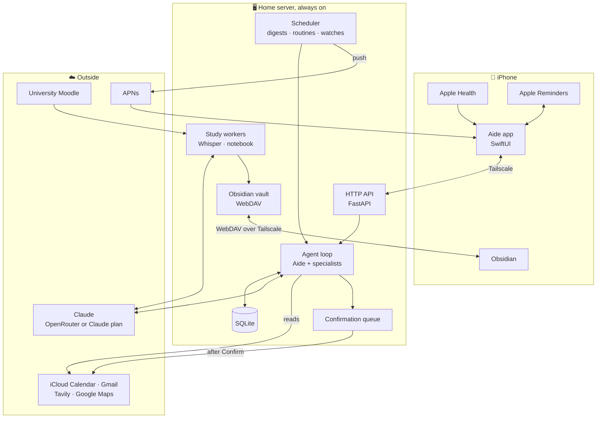
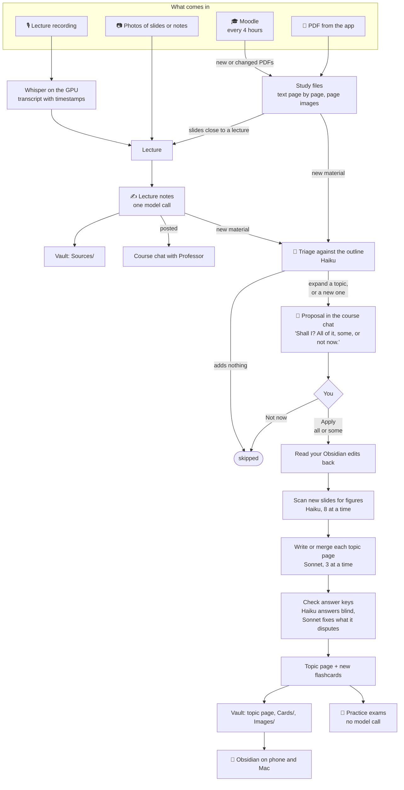
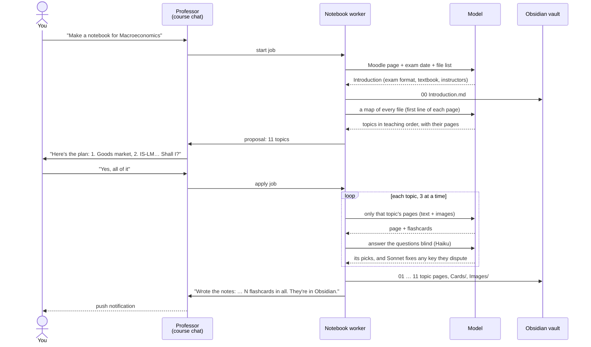

<p align="center">
  <picture>
    <source media="(prefers-color-scheme: dark)" srcset="brand/logo/web/pebble-white.svg">
    
  </picture>
</p>

<h1 align="center">Aide</h1>

<p align="center">
  A personal assistant for one person, backed by Claude.<br>
  Calendar, reminders, mail, health, habits and study notes, through chat on the phone.
</p>

---

Aide is a Python server that runs on a home machine and an iOS app that talks to it over Tailscale. You chat with
**Aide**, which hands the work to a small team of specialists, each with its own chats, tools and memory:

| Agent | Looks after |
|---|---|
| **Aide** | the orchestrator: web, maps, memory, routines; asks the others |
| **Secretary** | calendar (iCloud), reminders (Apple Reminders), mail (Gmail) |
| **Professor** | courses, lectures, study files, course notebooks, practice exams |
| **Coach** | Apple Health, sleep and recovery, habits, food |
| **Finance** | money (memory only, for now) |

Anything destructive or outward-facing (sending mail, deleting an event, moving a reminder) is queued in code and
runs only after you tap **Confirm** in the app. The model never runs it directly.

The API is in [docs/API.md](docs/API.md), the contract between the server and the app. [SPEC.md](SPEC.md) is the
original plan, and [CLAUDE.md](CLAUDE.md) is where things stand.

## How it fits together



## How study notes are made

Professor turns everything a course produces (lecture recordings, slides, Moodle PDFs) into notes you can study
from, in Obsidian on the phone and the Mac. Two kinds of notes come out of it:

- **Lecture notes**: one page per lecture, written as soon as the lecture is in.
- **A course notebook**: an Introduction on the exam, then one page per topic in the order it's taught, with an
  explanation, key terms, formulas, worked examples, figures from the slides, exam-style questions with checked
  answer keys, and flashcards. It grows as new material comes in, but nothing is written until you say yes.

### From material to notes



The model calls run in background workers, one job at a time, outside the chat turn that asked for them. They go
through OpenRouter or through your Claude plan (Claude Code on the server, `claude -p`), as set in the app under
Settings → *Who writes the notes*. When the plan hits its limit, the job pauses and Professor asks whether to wait
for the reset or finish on OpenRouter.

### Starting a notebook



### Example: a new PDF on Moodle, a week later

1. Moodle sync finds `Lecture 7 - Open economy.pdf` and adds it to the course's study files.
2. Triage reads the notebook's **outline** (titles, summaries, headings, not the text) and the file's page map,
   and finds what's new:
   > New in Macroeconomics: Lecture 7 - Open economy.pdf. I'd add to the notes:
   > 1. Expand **IS-LM model**: the open-economy IS curve with net exports (p. 3–6)
   > 2. New topic **Exchange rates**: nominal vs. real, uncovered interest parity (p. 7–15)
   >
   > Shall I? All of it, some, or not now.
3. You answer "just 2" in the chat, or tap **Apply** in the Study tab.
4. The worker pulls your latest edits from Obsidian, writes *Exchange rates* from pages 7–15 only, checks its
   answer keys, and slots it in after *IS-LM model*. Its flashcards are **appended** to `Cards/`, so the
   Spaced Repetition plugin's review history is never lost.

What ends up in the vault for one course:

```
Aide/Macroeconomics/
├── 00 Introduction.md          the exam, textbook, instructors
├── 01 The goods market.md      explanation · key terms · formulas · worked examples
├── 02 The IS-LM model.md       · figures · exam-style questions (folded answers)
├── …
├── Cards/                      question :: answer, tagged #flashcards/macroeconomics
├── Images/                     slide figures the topic pages show
├── Sources/                    one page per lecture: its notes
└── Files/                      the PDFs
```

Topic pages are shared: edit them in Obsidian and your wording stands; Aide builds on it the next time it adds
material. Any other page you edit becomes yours, and Aide leaves it alone.

## Layout

```
src/aide/
  __main__.py            entry point: wires settings, db, agent, API, background jobs
  config.py              settings from the environment
  db.py                  SQLite (WAL): conversations, messages, audit_log
  agent.py               Claude tool-use loop, conversation history, the confirmation queue
  agents.py              Aide and the specialists: prompts, tool sets, colours, starters
  tools/                 everything that touches the outside world: calendar, reminders, mail, web, maps…
  channels/api.py        the HTTP API the app uses (FastAPI)
  scheduler.py           background jobs; routines.py: scheduled agent jobs and watches
  digest.py              daily, weekly and monthly digests; objectives.py: each specialist's objectives
  reminders.py, habits.py, food.py, photos.py
  health.py, wake.py     Apple Health days and usual numbers; the wake-up briefing
  gmail.py, gmail_auth.py  Gmail API client; one-time OAuth sign-in script
  push.py                APNs pushes and the devices table
  study.py, whisper.py   courses, lectures and their notes; transcription on the GPU
  material.py, moodle.py study files (PDFs) and the Moodle sync
  notebook.py, quiz.py   course notebooks; practice exams
  engine.py              who writes the notes: OpenRouter or the Claude plan
  vault.py, webdav.py    the Obsidian vault and its WebDAV server
  backup.py              nightly backup of data/ (run by deploy/aide-backup.timer)
ios/Aide/                the iOS app (SwiftUI, iOS 17+)
brand/                   Pebble, the logo
deploy/                  systemd units
```

## Run your own

Aide is built for one person on their own machine, with nothing shared: your server, your tailnet, your keys.
Everything personal lives in `.env` (git-ignored) and in `data/` (git-ignored), never in the code.

**You need:**
- A Linux machine that stays on (a mini PC is plenty; an NVIDIA GPU only for lecture transcription), with
  Python 3.12, [uv](https://docs.astral.sh/uv/) and `poppler-utils` (for the study PDFs).
- [Tailscale](https://tailscale.com) on that machine and on your iPhone (the free plan is fine). The server
  listens on localhost only; `tailscale serve` publishes it to your tailnet with a real HTTPS certificate. Nothing
  is open to the internet.
- An [OpenRouter](https://openrouter.ai) or Anthropic API key.
- A Mac with Xcode and [XcodeGen](https://github.com/yonaskolb/XcodeGen) (`brew install xcodegen`) for the app,
  and an Apple ID. A free one signs a build for your own phone for 7 days. Push notifications, and installs that last a
  year, need the paid Developer Program.

**Server:**

```bash
git clone https://github.com/filippocappa/aide ~/Developer/aide   # the systemd units expect this path
cd ~/Developer/aide
cp .env.example .env              # see the steps below
uv sync && uv run pytest
# run it as a service: see "Running as a service" below, then
sudo tailscale serve --bg http://127.0.0.1:8787    # https://<machine>.<tailnet>.ts.net
```

**App:**

```bash
cd ios/Aide
cp Config/Signing.local.xcconfig.example Config/Signing.local.xcconfig
#   DEVELOPMENT_TEAM: your team ID. AIDE_BUNDLE_ID: a bundle ID of your own (and APNS_BUNDLE_ID in .env to match).
#   A free Apple ID: leave AIDE_ENTITLEMENTS out (no push).
xcodegen generate
open Aide.xcodeproj               # run it on your phone
```

In the app, Settings: the server URL (`https://<machine>.<tailnet>.ts.net`) and your `AIDE_API_TOKEN`. Both are
kept on the phone (the token in the Keychain).

**Tuned for its first user, so check these:** the time zone (`AIDE_TIMEZONE`); the calendars the study side
reads (`AIDE_STUDY_CALENDAR`, `AIDE_EXAM_CALENDAR`: a course is an event title that repeats there); practice exams
score +1 / −0.25 / 0, as in one university's exams (`src/aide/quiz.py`); the Gmail consent screen's home page and
privacy policy (make your own, see [Gmail](#gmail)); the agents' prompts, in `src/aide/agents.py`.

### Setup, step by step

1. **Env file.** `cp .env.example .env` and fill in your OpenRouter (or Anthropic) key, `AIDE_TIMEZONE` and
   `AIDE_API_TOKEN` (the app's token).
2. **iCloud Calendar (optional).** Create an app-specific password at account.apple.com → Sign-In and Security, and set `ICLOUD_EMAIL` and `ICLOUD_APP_PASSWORD`. Without them the calendar tools are off.
3. **Gmail (optional).** See [Gmail](#gmail) below. Without it the mail tools are off.
   **Web search and Maps (optional)** are in [Web search and Maps](#web-search-and-maps); without their keys those tools are off.
4. **Push (optional).** See [Push notifications](#push-notifications). Without it nothing reaches the phone
   unless the app is open.
5. **Lecture transcription (optional).** On a box with an NVIDIA GPU and `ffmpeg`, `uv sync --extra whisper` adds
   faster-whisper and the CUDA libraries (about 2 GB); the model (about 1.6 GB) downloads on the first lecture.
   Without it, lectures from photos and text still work.
6. **Run.** `uv sync && uv run aide` (`uv sync --extra whisper` on the server). The API listens on localhost;
   `tailscale serve` publishes it to the phone.

Aide can list, search and create events on your iCloud calendars right away. Moving or deleting an event is queued: the app shows exactly what will change, and nothing happens until you confirm. Queued actions expire after 30 minutes. Recurring events are listed but can't be changed yet.

## Gmail

Aide reads and searches your mail, and sends or replies only after you confirm. It uses the Gmail API with
two scopes: `gmail.readonly` (read) and `gmail.send` (send as you). It can't delete, archive or label anything.

One-time setup in Google Cloud, by hand:

1. [console.cloud.google.com](https://console.cloud.google.com): create a project, e.g. "Aide".
2. **APIs & Services → Library → Gmail API → Enable.**
3. **Google Auth Platform → Branding:** app name "Aide", your address as support email and as developer
   contact (at the bottom of the page). Publishing also needs an app domain: home page
   `https://filippocappa.github.io/aide/`, privacy policy `https://filippocappa.github.io/aide/privacy.html`
   (both served from the `gh-pages` branch), authorized domain `filippocappa.github.io` (no `https://`). On your
   own fork, publish the `gh-pages` branch from your GitHub account and use those addresses instead.
   **Audience:** External.
4. **Data Access:** leave it empty. The sign-in script asks for the two scopes itself.
5. **Clients → Create client:** type **Desktop app**, name "Aide server". Copy the client ID and secret into
   `.env` as `GMAIL_CLIENT_ID` and `GMAIL_CLIENT_SECRET`.
6. **Audience → Publish app** ("In production"). Skip this and the refresh token dies after 7 days, which is
   Google's limit for apps in Testing. You don't need verification for an app only you use. Google warns
   "Google hasn't verified this app" when you sign in: click *Advanced → Go to Aide*.

Then sign in once, on the server:

```
uv run python -m aide.gmail_auth        # opens the consent page, writes GMAIL_REFRESH_TOKEN to .env
systemctl --user restart aide
```

The browser has to reach `http://127.0.0.1:8765` on the server. If you sign in from another computer (the
Mac), run it with `--paste` instead: when the browser says it can't connect, copy the whole address from the
address bar straight into the script's prompt, within a few minutes. (Or forward the port first with
`ssh -L 8765:127.0.0.1:8765 cappa`.) The token is never printed. If Aide later says Gmail
access expired, run the script again.

## Web search and Maps

Read-only tools, so they run without confirmation. Each one is on only when its key is set.

**Web search (Tavily).** Sign up at [tavily.com](https://tavily.com) (the free plan gives 1,000 searches a
month), copy the API key from the dashboard into `.env` as `TAVILY_API_KEY`. Aide gets `web_search` and
`fetch_page` (reads one page in full).

**Google Maps.** Aide gets `find_places` (Places API (New) Text Search) and `travel_time` (Routes API).

1. [console.cloud.google.com](https://console.cloud.google.com): pick a project (the Gmail one is fine) or make one.
2. **Billing:** link a billing account. Both APIs need it, even within Google's free monthly usage.
3. **APIs & Services → Library:** enable **Places API (New)** and **Routes API** (not the legacy "Places API"
   or "Directions API").
4. **APIs & Services → Credentials → Create credentials → API key.** Edit the key: under *API restrictions*
   choose *Restrict key* and tick only Places API (New) and Routes API. (No application restriction: the
   server calls from its own IP.) Copy it into `.env` as `GOOGLE_MAPS_API_KEY`.
5. Set `AIDE_HOME_ADDRESS` (e.g. `Via Roma 1, 20121 Milano`): "near me" and travel times start there. If you
   tell Aide you've moved, it remembers that and uses it instead.

Requests ask only for the fields Aide shows (field masks), which keeps them on the cheapest SKU that has them.
Then `systemctl --user restart aide`.

## Push notifications

The server sends pushes through APNs (docs/API.md, "Push"): a silent `sync` when reminders change on the
server, a `reminder` alert for one that never reached the phone, and a `digest` alert for each scheduled
digest. Without a key, or with no device registered, nothing is sent; it's all still in the app.

1. [developer.apple.com/account](https://developer.apple.com/account) → **Certificates, IDs & Profiles → Keys**
   → **+**. Name it (e.g. "Aide push"), tick **Apple Push Notifications service (APNs)**, register, and
   download the `.p8`. Apple lets you download it only once.
2. Note the **Key ID** (on the key's page) and your **Team ID** (Membership details, top right of the account
   page).
3. Keep the key outside the repo, readable only by you:
   ```bash
   mkdir -p ~/.config/aide && mv ~/Downloads/AuthKey_XXXXXXXXXX.p8 ~/.config/aide/
   chmod 600 ~/.config/aide/AuthKey_XXXXXXXXXX.p8
   ```
4. In `.env`: `APNS_KEY_PATH=/home/<you>/.config/aide/AuthKey_XXXXXXXXXX.p8`, `APNS_KEY_ID`, `APNS_TEAM_ID`,
   and `APNS_BUNDLE_ID` (default `com.filippocappa.aide`, from `ios/Aide/project.yml`). Then
   `systemctl --user restart aide`.

The app registers its device token on launch. Debug builds from Xcode use the sandbox APNs host, TestFlight
and App Store builds production; the server picks the host from what each device registered with. Check with
`GET /v1/devices`, and send a test with `POST /v1/devices/test`. One key works for both hosts and doesn't
expire; revoking it in the portal stops all pushes.

## Obsidian

Aide writes the study notes and files into an Obsidian vault on this server (`data/obsidian/Uni`, everything under
`Aide/`), and serves it over WebDAV, so Obsidian syncs it to the phone and the Mac with the free **Remotely Save**
plugin, over Tailscale. Pages you edit in Obsidian are yours: Aide doesn't touch them again. Except a course
notebook's topic pages: Aide reads your edits back and builds on them when it adds new material.

**Server, once:**
1. In `.env`: `AIDE_WEBDAV_PASSWORD` (generate one: `python3 -c "import secrets; print(secrets.token_urlsafe(18))"`)
   and `AIDE_WEBDAV_URL=https://<this machine>.<tailnet>.ts.net:8443`. Optional: `AIDE_VAULT_NAME` (default `Uni`),
   `AIDE_VAULT_DIR` (default `data/obsidian`), `AIDE_WEBDAV_PORT` (default 8789).
2. The WebDAV service, next to Aide's:
   ```bash
   ln -sf "$PWD/deploy/aide-webdav.service" ~/.config/systemd/user/aide-webdav.service
   systemctl --user daemon-reload
   systemctl --user enable --now aide-webdav
   sudo tailscale serve --bg --https=8443 http://127.0.0.1:8789   # tailnet only, with a real certificate
   systemctl --user restart aide
   ```

**Each device** (phone and Mac; Tailscale on):
1. Install Obsidian, create a vault named **Uni** (the same name as `AIDE_VAULT_NAME`).
2. Settings → Community plugins → turn them on → Browse → **Remotely Save** → Install → Enable.
3. Remotely Save's settings: remote service **WebDAV**; address, user and password as the app shows them (Settings
   → Obsidian), or from `GET /v1/vault`; auth type **basic**; depth "supports depth 1". Check the connection.
4. Sync on start and every few minutes (Remotely Save's "schedule for auto run"), or tap its sync icon.
5. For the flashcards: Community plugins → Browse → **Spaced Repetition** → Install → Enable. In its settings, set
   the flashcard tags to `#flashcards` (the default) and the inline separator to `::`. Each course's cards are in
   `Aide/<course>/Cards/`, tagged `#flashcards/<course>`; review them from the command palette ("Review flashcards").

`data/obsidian` isn't in the nightly backups: Aide's pages come from the database, and your own pages are on your
devices too. To rebuild Aide's pages, delete `Aide/` and the `vault_files` rows (else Aide takes them for pages you
deleted, and leaves them gone).

## Moodle

Course PDFs from the university's Moodle, every 4 hours (docs/API.md, "Moodle"). Set `AIDE_MOODLE_URL` in `.env`
(UniTo: `https://elearning.unito.it/sme`), restart, then log in from the app (Study → Moodle): it's the university's
own login page, so the password stays with you; the server keeps only Moodle's token, as `MOODLE_TOKEN` in `.env`.
Logging out in the app removes it.

## Tests

```
uv run pytest
```

## Running as a service

Aide runs as a systemd **user** service straight from this checkout, reading `.env` here. It starts at boot and restarts on crashes.

```bash
mkdir -p ~/.config/systemd/user
ln -sf "$PWD/deploy/aide-user.service" ~/.config/systemd/user/aide.service
systemctl --user daemon-reload
systemctl --user enable --now aide
sudo loginctl enable-linger "$USER"   # keep running while logged out, and start at boot
```

Day to day:

```bash
systemctl --user status aide          # is it running?
systemctl --user restart aide         # after a git pull or editing .env
journalctl --user -u aide -f          # live logs
```

The database is `data/aide.db` in this folder. `deploy/aide.service` is a hardened system-wide alternative (dedicated `aide` user, `/opt/aide`) if you ever want that instead.

## Backups

Every night at about 03:30 a user-level timer copies `data/` to `~/aide-backups/YYYY-MM-DD/`. Databases are
copied with SQLite's online backup (safe while Aide is running) and the copy must pass `integrity_check`, or the
run fails and no folder is written. The Gmail refresh token lives in `.env`, not the database, so its
`GMAIL_*` lines go into `gmail.env` next to it (mode 600; the folder is 700). Nothing else from `.env` is copied,
and none of it is in git. It keeps the newest 14 backups plus the newest of each of the last 8 weeks.
Photos (`data/photos/`) never change, so they go once into `~/aide-backups/photos/`, which pruning leaves alone;
study PDFs (`data/files/`) go the same way into `~/aide-backups/files/`. Lecture recordings (`data/audio/`) aren't
backed up (their transcripts are).

```bash
ln -sf "$PWD/deploy/aide-backup.service" ~/.config/systemd/user/aide-backup.service
ln -sf "$PWD/deploy/aide-backup.timer" ~/.config/systemd/user/aide-backup.timer
systemctl --user daemon-reload
systemctl --user enable --now aide-backup.timer
systemctl --user start aide-backup          # run one now
journalctl --user -u aide-backup -n 20     # "backup ok: …" or "backup FAILED: …"
systemctl --user list-timers aide-backup.timer
```

**Restore.** Stop the service first, so it doesn't write to the old database while you swap it:

```bash
systemctl --user stop aide
mv data data.broken                          # keep the old one until you're sure
mkdir data && cp ~/aide-backups/2026-10-18/aide.db data/
cp -r ~/aide-backups/photos ~/aide-backups/files data/
systemctl --user start aide
```

The copy is a single self-contained file (no `-wal`/`-shm` needed). If `.env` was lost too, rebuild it from
`.env.example` and paste in the lines from `gmail.env`; the other secrets (OpenRouter, iCloud, API
token) aren't backed up and have to be re-entered or regenerated. The same goes for the APNs `.p8`: if it's
lost, revoke it and make a new one (README, "Push notifications"). Devices are in the database, so they come
back with it.

## Notes

- LLM: OpenRouter (`OPENROUTER_API_KEY`) or the Anthropic API directly (`ANTHROPIC_API_KEY`). Haiku 5.5 by default, Sonnet 5.5 after "think harder" in the app (`/v1/think`); override with `AIDE_MODEL` / `AIDE_SMART_MODEL`. Voice chats in the app are transcribed by
  `google/gemini-3.5-flash-lite` over OpenRouter (`AIDE_TRANSCRIBE_MODEL` to change it; off without an OpenRouter key). Prompt caching is on for both; server-side refusal fallback only works direct, and not on Haiku.
- Each turn is saved to SQLite only after it completes. A crash mid-turn loses that turn but never corrupts history.
- Every tool call is written to `audit_log`.
