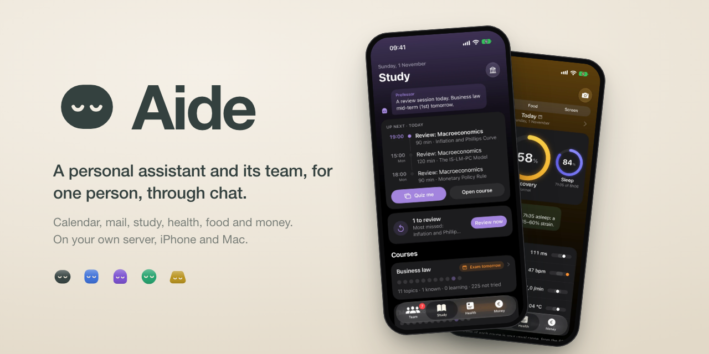
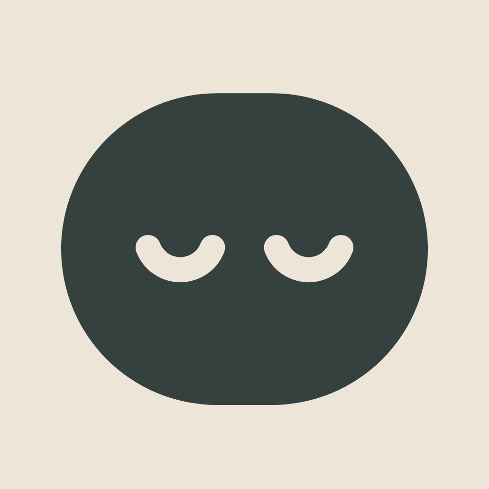
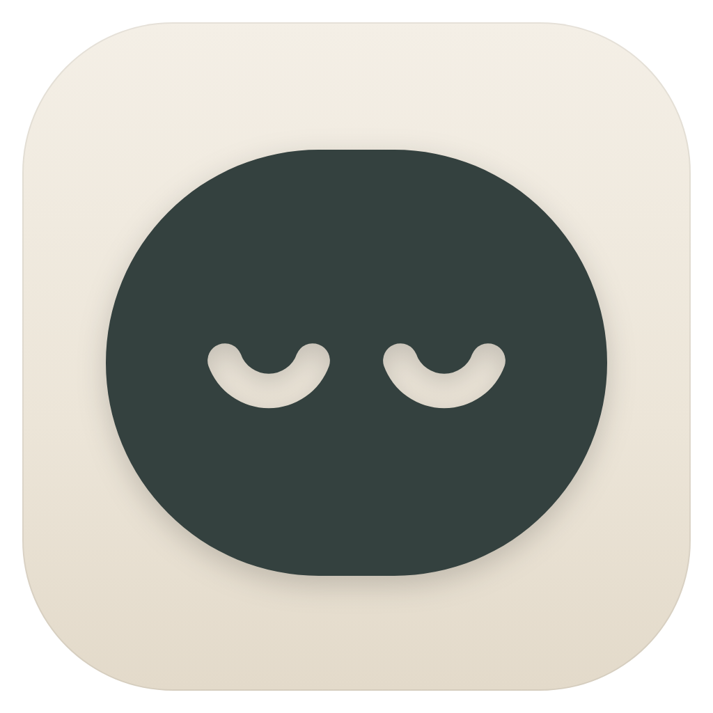
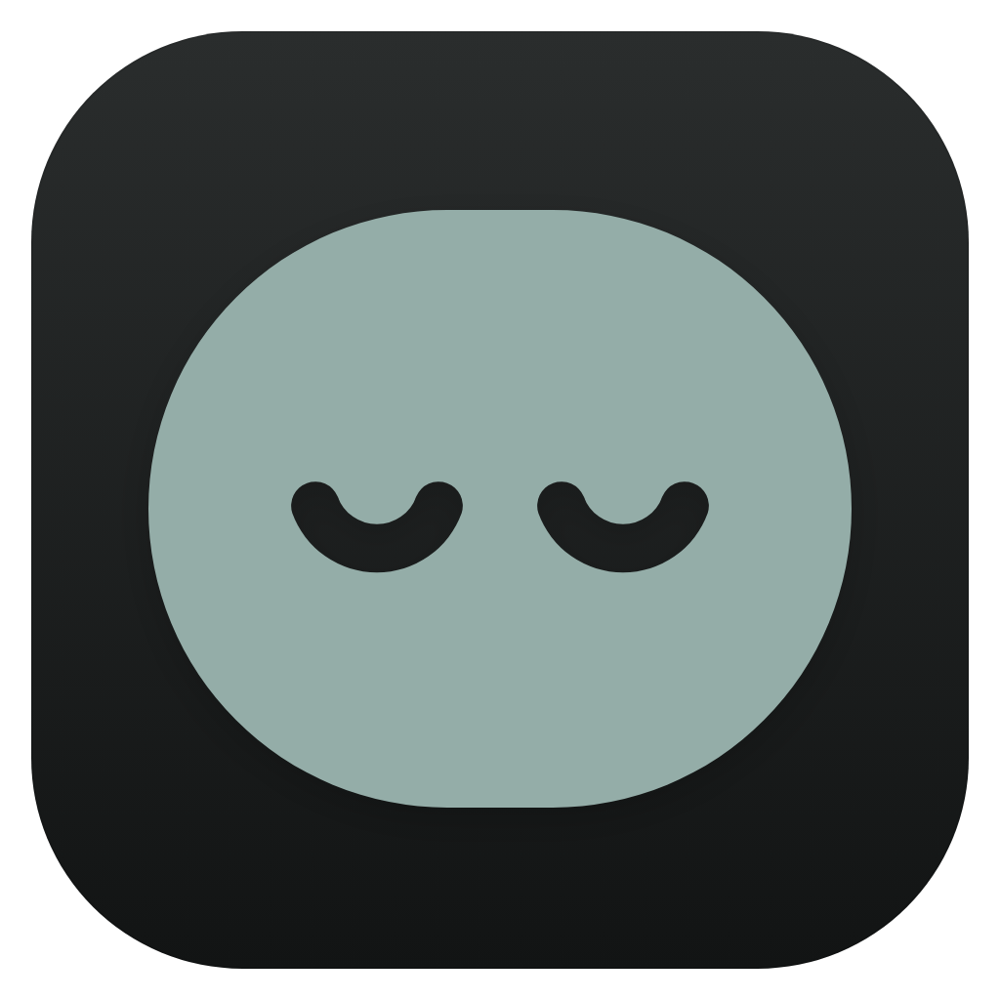
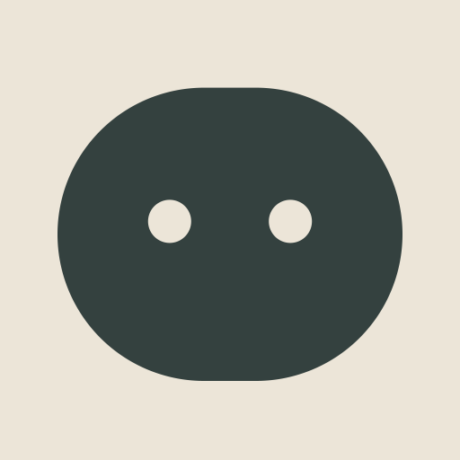
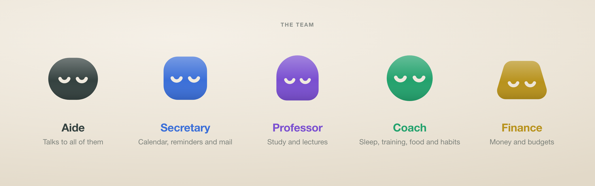
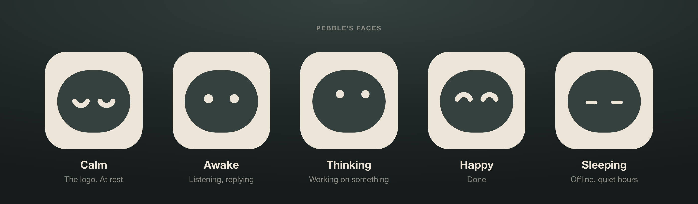
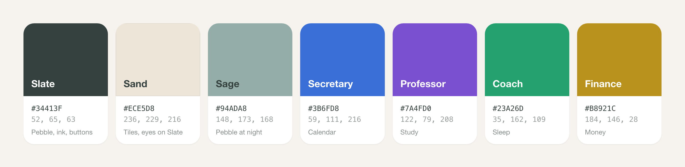
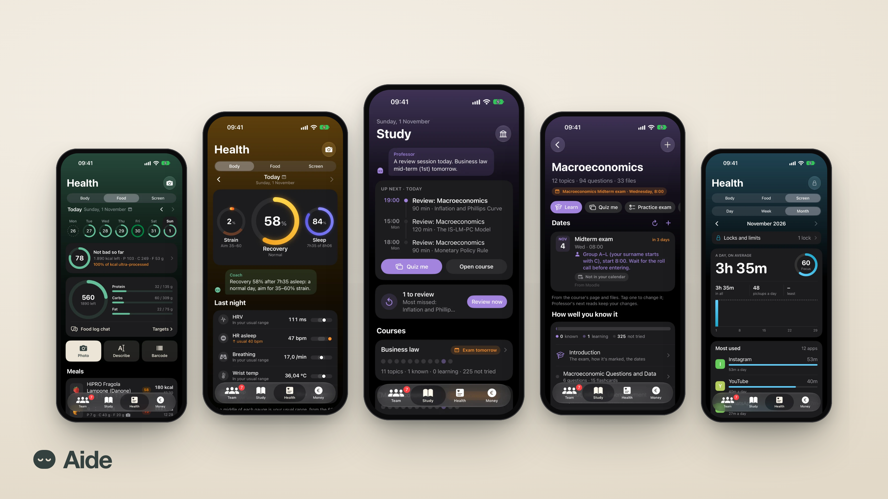
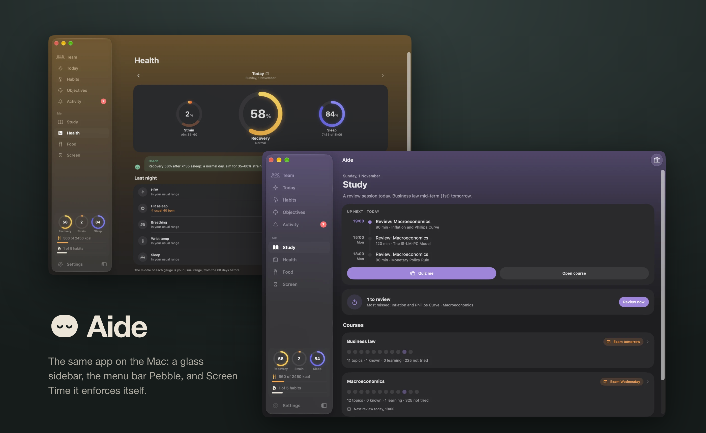

<p align="center"></p>

# Aide brand kit

Pebble, its family, the colours, the screenshots and the promo images, all in one place. Everything here is drawn
by the two scripts in [`source/`](source); nothing is hand-edited.

| Folder | What's in it |
|---|---|
| [`logo/`](logo) | SVG masters: Pebble in black, Slate and white, the small cut, the faces, the family, the breathing animation |
| [`png/`](png) | PNG exports: the same marks at 1024 px, the lockups, the avatar, the app icon (light and dark) |
| [`promo/`](promo) | Ready-made images: GitHub's social preview, iPhone and Mac shots, the team, the faces, the palette |
| [`screenshots/`](screenshots) | The app as it is: [iPhone](screenshots/iphone) (600 × 1304) and [Mac](screenshots/mac) (1600 × 1058) |
| [`source/`](source) | `pebble.py` (the geometry, writes `logo/` and the app icon's layer) and `render.py` (writes `png/` and `promo/`) |

## Pebble

A smooth stone with content, closed eyes: Aide at rest, nothing to worry about.

<p>
  
  
  
  
</p>

| File | Use |
|---|---|
| `logo/pebble-slate.svg`, `png/pebble-slate.png` | The colour mark, on light backgrounds |
| `logo/pebble.svg`, `png/pebble-black.png` | One colour, black |
| `logo/pebble-white.svg`, `png/pebble-white.png` | On dark backgrounds and photos |
| `logo/pebble-small.svg` | 16 to 32 px: a bigger body, heavier eyes (the Mac menu bar's Pebble) |
| `png/lockup-slate.png`, `png/lockup-white.png` | Pebble with the name, for headers and slides |
| `png/avatar.png` | Profile pictures: Pebble on a Sand tile, safe for a circle crop |
| `png/app-icon-light.png`, `png/app-icon-dark.png` | The app icon, flat, for pages and slides (the real one is `ios/Aide/Aide/AppIcon.icon`) |
| `logo/idle.gif`, `logo/idle.svg` | Pebble breathing, with a blink every ~4 s (the SVG is CSS and respects reduced motion) |

The eyes are holes, not white shapes, so whatever is behind shows through. The app icon is an Icon Composer
document with one layer, Pebble, from `pebble.py`. Its colours per appearance are in its `icon.json`: Slate on
Sand in light, Sage on near-black in dark, a white Pebble when tinted. iOS and macOS add the glass themselves.

## The family

Each agent is its own little creature with Pebble's eyes, told apart by shape as well as colour. In the app they
breathe, blink and look around (`ios/Aide/Aide/Support/Figure.swift`); here they're at rest. SVGs in
`logo/family/`, shaded PNGs in `png/family/`.

<p align="center"></p>

## Faces

Pebble's expression follows what's happening in a chat. SVGs on a Sand tile in `logo/expressions/`, PNGs in
`png/expressions/`.

<p align="center"></p>

## Colours

<p align="center"></p>

| Name | HEX | Use |
|---|---|---|
| Slate | `#34413F` | Pebble, ink, buttons in light mode |
| Sand | `#ECE5D8` | Tiles, eyes on Slate, buttons in dark mode |
| Sage | `#94ADA8` | Pebble on the dark app icon |
| Secretary | `#3B6FD8` | Calendar, reminders and mail |
| Professor | `#7A4FD0` | Study: the Study tab's one hue |
| Coach | `#23A26D` | Sleep, training, food and habits |
| Finance | `#B8921C` | Money |

The agents' colours come from the server (`src/aide/agents.py`); the app lightens them a little in dark mode.
Type is the system's: SF Pro in the app and in these images.

## Screenshots and promo

<p align="center"></p>
<p align="center"></p>

- `promo/social-preview.png` (1280 × 640) is sized for GitHub: the repo's Settings → General → Social preview.
- `promo/iphone.png` (3200 × 1800) and `promo/mac.png` (2800 × 1720) are for slides and posts.
- The raw screens are in `screenshots/`, with the status bar at 09:41 and the data from 1 November 2026.

## Rules

- **Clear space:** keep at least one eye-width (~26 units on the 256 grid) free around Pebble.
- **Minimum size:** 24 px for the regular mark. Below that, use `pebble-small.svg`.
- **Don't:** stretch it, add outlines, shadows or gradients to the flat mark, give it a mouth, or colour the eyes
  apart from the background.
- The family's soft shading (light from above) is for the agents in the app and the promo images; the logo stays flat.

## Making it again

```bash
python3 brand/source/pebble.py        # the SVGs in logo/ and the app icon's layer
python3 brand/source/render.py        # png/ and promo/ (needs Google Chrome; render.py promo/team for one)
uv run --no-project --with cairosvg --with pillow python3 brand/source/pebble.py --gif   # logo/idle.gif
```

Change the geometry in `pebble.py` (Pebble, the faces, the family) and the layouts in `render.py`. New
screenshots go in `screenshots/` under the same names, then run `render.py` again.
