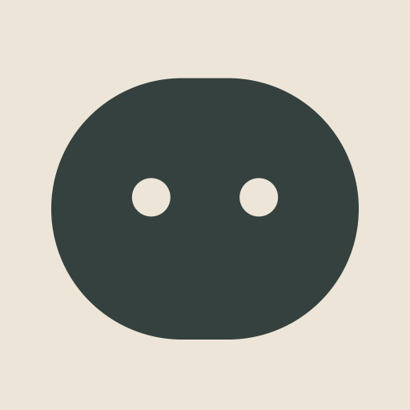

# Pebble: Aide's logo and mascot

A smooth stone with content, closed eyes: Aide at rest, nothing to worry about.



## Colours

| Name  | HEX       | RGB           | Use |
|-------|-----------|---------------|-----|
| Slate | `#34413F` | 52, 65, 63    | Pebble itself |
| Sand  | `#ECE5D8` | 236, 229, 216 | Background tile, eyes on Slate |

Pebble also works in plain black or white (`logo/web/pebble-black.svg`, `pebble-white.svg`). The eyes are real holes, so whatever is behind shows through.

## Expressions

| File | When |
|------|------|
| `logo/expressions/calm.svg` | Default. The logo. |
| `logo/expressions/awake.svg` | Listening, replying |
| `logo/expressions/thinking.svg` | Working on something (`!think`, long tool runs) |
| `logo/expressions/happy.svg` | Done, habit completed |
| `logo/expressions/sleeping.svg` | Offline, quiet hours |

## Files

- `logo/avatar.png`: Discord bot avatar (1024 px, Sand tile).
- `logo/idle.gif`: animated avatar with breathing and a blink every ~4 s.
- `logo/idle.svg`: same animation in CSS, for web pages. It respects reduced-motion settings.
- `logo/pebble.svg`: black master. `pebble-slate.svg`: colour master.
- `logo/pebble-small.svg`: heavier cut for 16 to 32 px. The favicons are built from it.
- `logo/web/`: favicon.ico, PNG icons, app icon, webmanifest and a `<head>` snippet.
- `ios/Aide/Aide/AppIcon.icon`: the iPhone and Mac app icon, an Icon Composer document (open it in Icon Composer,
  in Xcode's Applications). One layer, Pebble, from `pebble.py`; the colours per appearance are in its `icon.json`:
  Slate on Sand in light, sage (`#94ADA8`) on near-black in dark, white Pebble when tinted. iOS and macOS draw the
  glass, the clear and tinted looks themselves, and Xcode makes flat PNGs for older systems.

## Rules

- **Clear space:** keep at least one eye-width (~26 units on the 256 grid) free around Pebble.
- **Minimum size:** 24 px for the regular mark. Below that, use `pebble-small.svg`.
- **Don't:** stretch it, add outlines, shadows or gradients, add a mouth, or recolour the eyes separately from the background.

## Editing

Everything is generated by `pebble.py` from one set of geometry. Change it there, then run:

```
uv run --no-project --with cairosvg --with pillow python3 brand/pebble.py --gif
```
